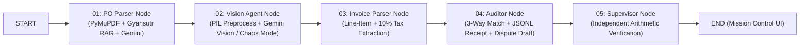

# Project Overlord // The Financial Defense Engine (PS-BA1)

**Autonomous Three-Way Invoice, Purchase Order & Goods-Receipt Reconciliation Platform**

Project Overlord eliminates Accounts Payable (AP) budget leakage by autonomously cross-referencing **Purchase Orders (PO)**, physical **Goods Receipts (GR)**, and **Vendor Invoices** in real time. Built with **Gyansutr RAG**, a **5-Node LangGraph `StateGraph`**, **Google Gemini (`gemini-3.5-flash`)**, **PyMuPDF**, **Pillow**, **QRCode**, and an **Obsidian Mission Control Gradio 6 UI**.

---

## 1. Problem Statement (`PS-BA1`)

Enterprises lose millions annually to **"The Fragmented Match"**:
- AP teams manually reconcile three disconnected records across PDFs, emails, warehouse dock photos, and ERP ledgers.
- Under Net-30 settlement pressure, human error allows **uncontracted surcharges** (e.g., hidden setup/consulting fees), **inflated unit rates**, and **short-shipped deliveries** (paying for 10 units when only 8 arrived) to pass unchecked.
- Existing tools operate as black boxes with no line-item visual explainability, no adversarial resilience, and no automated dispute or settlement closure.

**Project Overlord** replaces manual review with a zero-touch, auditable 5-agent reconciliation loop that executes in seconds.

---

## 2. System Architecture



### The 5-Agent LangGraph Swarm (`OVERLORD_GRAPH`)
1. **`po_parser_node` (Gyansutr Clause RAG + Gemini 3.5 Flash):**
   - Extracts text from live editor input or uploaded `.pdf`/`.txt` files (`pymupdf`).
   - Runs section-aware chunking (`clean_text`, `chunk_text`) and 64-dimensional hashed cosine similarity (`_embed_text`, `_cosine_sim`) to retrieve governing clauses (e.g., *Non-Billable Extras Clause*, *Short-Shipment Clause*) and authorized spend caps.
2. **`vision_agent_node` (Gemini Vision + PIL XAI + Chaos Mode):**
   - Normalizes uploaded Goods Receipt images via `PIL.Image` (`preprocess_gr_image`).
   - Calls `gemini-3.5-flash` Vision (with a 4–6s non-blocking timeout and deterministic fallback so live demos never stall).
   - **Vision XAI Bounding Boxes:** On short-delivery fraud (Scenario B: 8/10 GPUs delivered), `draw_vision_xai_bounding_box()` draws a high-contrast red box (`MISSING INVENTORY: 2 OF 10 UNITS`) directly over the warehouse receipt image.
   - **Chaos Mode:** When toggled on in the sidebar, injects randomized real-world visual anomalies (`[VISION ALERT] Logo not visible...`) to verify active Short-Payment Hold protection.
3. **`invoice_parser_node` (Dynamic Line-Item & Tax Parser):**
   - Extracts invoice IDs (`INV-...`), itemized charges, subtotals, and optional 10% tax calculations (`Apply 10% Tax Node`) from live edited text or uploaded PDFs.
4. **`auditor_node` (Reconciliation & Dispute Engine):**
   - Compares every invoice line item against contracted PO items and GR delivered counts (`reconcile_three_way`).
   - Flags uncontracted fees, rate inflation, and quantity shortages, drafts a legally grounded vendor dispute email, and writes an fsync'd JSONL audit record to `workspace/receipts/overlord_audit.jsonl`.
5. **`supervisor_node` (Independent Verification Gate):**
   - Independently verifies the Auditor's arithmetic (e.g., `[SUPERVISOR AGENT] 600 - 500 = 100. Calculations mathematically verified. Routing to Dispute.`) before unlocking downstream actions.

---

## 3. Complete Feature Breakdown

| Feature | Where in UI | What It Does |
| :--- | :--- | :--- |
| **Multi-Scenario Matrix** | Left Sidebar (`Demo Scenario`) | One-click presets: **Scenario A** (`$100` Unauthorized Setup Fee), **Scenario B** (`$2,000` Short-Delivery GPU Fraud), and **Scenario C** (`$0.00` Clean 3-Way Match). |
| **Audit Modes & Tax Hook** | Left Sidebar (`Audit Mode` / `Apply 10% Tax Node`) | Switch between `3-Way Match`, `2-Way Match`, and `4-Way Match (Tax Verification)` (`TAX-DOC-2024-8842`), plus a live 10% Tax Node checkbox. |
| **Chaos Mode** | Left Sidebar (`Chaos Mode`) | Injects live adversarial Vision failures (`38.4%` confidence alert) mid-demo to prove the Vision pipeline isn't hardcoded. |
| **Live PDF / Text Ingestion** | Cols 1 & 3 (`Edit / Upload PDF` tabs) | Upload custom `.pdf` or `.txt` Purchase Orders and Invoices (parsed via `pymupdf`) or edit amounts live and watch XAI diffing recompute. |
| **3-Column XAI Visual Diffing** | Top Workspace (`01 / PO`, `02 / GR`, `03 / Invoice`) | Highlights authorized PO amounts in green (`.hl-ok`), pulses unauthorized invoice fees/totals in red (`.hl-flag-pulse`), and flashes `TOTAL RECOVERED` in the header. |
| **Vision XAI Bounding Box** | Col 2 (`02 / GOODS RECEIPT`) | Dynamically draws a red bounding box over empty manifest bays when units are missing (Scenario B). |
| **Explainable AI Chatbot** | Bottom Left (`Chat with the Auditor`) | Context-injected `gr.Chatbot` powered by Gemini 3.5 Flash with grounded offline fallback, domain guardrails (politely rejects off-topic questions like *"What is the capital of France?"*), and 4 quick-ask buttons: **Why did you flag this?**, **Summarize Invoice**, **Draft Payment Approval**, and **What if the invoice was $450?**. |
| **Send Dispute Kill Shot** | Bottom Right (`Send Dispute to Vendor`) | Dispatches the dispute email, displays `[SUCCESS] Dispute dispatched to vendor via API. Funds secured.`, logs to JSONL, and pops up an annualized scale ROI toast (`$120,000 saved this year` at 5,000 invoices/month). |
| **UPI Checkout Gateway** | Bottom Right (`Proceed to Payment`) | Generates a live local QR code via `qrcode` for `upi://pay?pa=9458175464@yesfam&pn=ProjectOverlord&am=500.00&cu=INR` (with raw URI fallback textbox) and a **Simulate Payment Success** button that logs `PAID ($500.00)` to the ledger. |
| **Zero-Code Policy Hot-Swap** | Live Audit & Copilot (`⚡ Policy Hot-Swap`) | Add/edit JSON or YAML rules (or upload config files) via UI or MCP without code edits; forces a red **POLICY EXCEPTION — PAYMENT BLOCKED** hold even on clean matches. |
| **Executive Boardroom Brief** | Tab 3 (`CFO Boardroom`) | One-click citation-backed **PDF, Markdown, or CSV** export ranking Top 3 urgent exceptions with exact source lines, policy rules, telemetry logs, and Supervisor/Vision math gates. |
| **Governed Improvement Agent** | Tab 3 (`CFO Boardroom` -> Section 05) | Captures human reviewer verdicts (`confirmed`, `false_positive`, `needs_review`) in SQL and drafts policy severity updates only after repeated independent evidence (human approval required). |
| **Multi-Tier LLM Routing** | Left Sidebar (`LLM Engine`) | Supports `Auto (Gemini -> Local Ollama)`, `Local Only (Ollama: Qwen 5B / OLMoE)` (text-only), and `Offline Deterministic` with sub-second unreachable fast-fail. |
| **Compliance Ledger & Export** | Tab 2 (`Compliance Ledger & Export`) + Sidebar | Backed by SQLAlchemy (SQLite / PostgreSQL `DATABASE_URL`) + SHA-256 hash-chained compliance events + append-only `workspace/receipts/overlord_audit.jsonl`, plus JSON Audit Certificates. |
| **MCP Server (`mcp_server.py`)** | `python mcp_server.py` (stdio) | Exposes 11 governed FastMCP tools sharing the live SQL database and deterministic policy engine. |
| **Donut Challenge Hooks** | Bottom of `app.py` | Pre-built commented-out LangGraph nodes (`translate_dispute_email()`, `calculate_tax()`) ready for rapid live judging twists. |

---

## 4. Repository Structure

```text
ZeroTouch-AP-Auditor/
├── app.py                        # Complete application (RAG + 5-node LangGraph + Gradio 6 Obsidian UI)
├── policy_engine.py              # Deterministic hot-reloadable JSON/YAML policy parser & evaluator
├── policies.json                 # Externalized active policy ruleset (POL-001, POL-002, ...)
├── executive_brief.py            # Citation-backed Executive Boardroom Brief (PDF, Markdown, CSV)
├── overlord_db.py                # SQLAlchemy ORM persistence + SHA-256 hash-chained compliance ledger
├── mcp_server.py                 # 11-tool FastMCP stdio server sharing SQL DB & policy engine
├── improvement_agent.py          # Governed continuous-improvement policy drafting agent
├── requirements.txt              # Runtime Python dependencies
├── requirements-dev.txt          # Test, lint & pitch-deck dependencies (pytest, ruff, python-pptx)
├── pyproject.toml                # Project metadata, pytest & ruff configuration
├── .env.example                  # Safe template for Gemini, Ollama, and DATABASE_URL variables
├── .gitignore                    # Excludes .env, .venv, caches, SQLite DBs, and export artifacts
├── run.ps1                       # Windows one-command launcher (.venv, tests, Docker)
├── run.sh                        # macOS/Linux one-command launcher
├── Dockerfile                    # Containerized deployment image
├── .github/workflows/ci.yml      # GitHub Actions CI (ruff lint, offline pytest, Docker smoke test)
├── scripts/
│   └── create_pitch_deck.py      # Generator for Project_Overlord_Pitch_Deck.pptx
├── tests/
│   ├── test_overlord.py          # Core workflow, XAI chatbot, chaos, Policy Hot-Swap tests
│   ├── test_donuts.py            # Donut 1 & 2 + Ollama fast-fail integration tests
│   ├── test_policy_engine.py     # JSON/YAML validation, atomic save, clean-match override tests
│   ├── test_executive_brief.py   # Citation-backed executive brief model & export tests
│   ├── test_executive_brief_phase2.py # Phase 2 brief citations, ROI, & error padding tests
│   ├── test_database_mcp.py      # SQLAlchemy persistence, SHA-256 ledger chain, & MCP tool tests
│   └── test_improvement_agent.py # Governed feedback aggregation & non-auto-activation tests
├── workspace/
│   ├── receipts/                 # Immutable fsync'd JSONL audit trail (overlord_audit.jsonl)
│   └── exports/                  # Exported Audit Certificates & Boardroom Briefs
├── BUILD_OVERVIEW.md             # Architecture & product positioning guide
├── DATABASE_AND_MCP.md           # SQL schema, PostgreSQL setup, and MCP server guide
├── PITCH_PREP.md                 # Competition pitch timing, judge Q&A, and recovery runbook
├── DEMO_SCRIPT.md                # 3-minute live Broadway pitch script
├── PITCH_DECK.md                 # Obsidian pitch deck specification & designer notes
├── Project_Overlord_Pitch_Deck.pptx # Competition slide deck
└── SUBMISSION.md                 # Hackathon portal submission copy
```

---

## 5. Configuration & Environment Variables

Create `.env` from `.env.example` (`.env` is gitignored so keys are never committed):

| Variable | Default | Description |
| :--- | :--- | :--- |
| `GOOGLE_API_KEY` | *(empty)* | Google Gemini API key. If absent or `OVERLORD_LIVE_LLM=0`, the app runs deterministically offline with zero crashes. |
| `OVERLORD_LIVE_LLM` | `0` (`1` when live) | `1` enables live Gemini API calls (`google-genai`) with non-blocking timeout protection; `0` uses offline deterministic mode. |
| `GEMINI_PRO_MODEL` | `gemini-3.5-flash` | Model used for PO verification and XAI Auditor Chatbot. |
| `GEMINI_VISION_MODEL` | `gemini-3.5-flash` | Multimodal model used for Goods Receipt image verification. |
| `GEMINI_FALLBACK_MODEL` | `gemini-3.1-flash-lite` | Automatic fallback model if the primary model errors or is unavailable. |
| `GRADIO_SERVER_PORT` | `7860` | Web server port. |
| `GRADIO_ANALYTICS_ENABLED` | `False` | Disables Gradio telemetry in CI/local demos. |
| `DATABASE_URL` | *(SQLite fallback)* | Optional managed PostgreSQL connection URL (`postgres://` or `postgresql://`); defaults to local `workspace/overlord.sqlite3`. |
| `OLLAMA_HOST` | `http://127.0.0.1:11434` | Optional local Ollama endpoint for text-only fallback when Gemini is unavailable. |
| `OVERLORD_LOCAL_MODEL` | `qwen2.5:5b` | Preferred local Ollama model (`qwen3:4b`, `qwen2.5:3b`, `olmoe:1b-7b` fallbacks supported). |

---

## 6. Installation, Running & Testing

### Option A: One-Command Launchers
- **Windows (PowerShell):**
  ```powershell
  .\run.ps1            # Create .venv, install requirements, start UI at http://127.0.0.1:7860
  .\run.ps1 -Test      # Install dev deps and run pytest
  .\run.ps1 -Docker    # Build and run Docker container on port 7860
  ```
- **macOS / Linux:**
  ```bash
  chmod +x run.sh
  ./run.sh             # Create .venv, install requirements, start UI at http://127.0.0.1:7860
  ./run.sh --test      # Install dev deps and run pytest
  ./run.sh --docker    # Build and run Docker container on port 7860
  ```

### Option B: Manual Python Setup
```bash
pip install -r requirements.txt
python app.py
```
Open **http://localhost:7860** in your browser.

### Running Tests & Linting
```bash
# Run full automated test suite
python -m pytest -v

# Optional linter (requires ruff from requirements-dev.txt)
ruff check .
```

---

## 7. Golden Path Live Demo Script

1. **Scenario A (`$100` Overcharge):** Leave the default scenario selected (`PO #8842` at `$500.00` vs `INV-2024-001` at `$600.00`) and click **Execute 3-Way Match**. Watch the 5-node telemetry stream (`po_parser` → `vision_agent` → `invoice_parser` → `auditor` → `supervisor`), green/red XAI highlights, and `TOTAL RECOVERED: $100.00`.
2. **XAI Chatbot:** Click **`Why did you flag this?`** (or type `"What is the invoice about?"`) to demonstrate context-grounded reasoning, then optionally test **`What if the invoice was $450?`** or an off-topic guardrail prompt.
3. **Send Dispute -> Scale Popup:** Click **Send Dispute to Vendor** to fire the green `[SUCCESS]` API banner and the scale ROI toast (`$120,000 saved this year`).
4. **Scenario B -> Vision XAI Bounding Box:** Switch **Demo Scenario** to **`Scenario B: Short-Delivery GPU Fraud ($2,000 Overcharge)`** and click **Execute 3-Way Match**. Show the red bounding box drawn directly on `02 / GOODS RECEIPT` and `[VISION XAI] Bounding box drawn over missing inventory.`.
5. **UPI Checkout:** Click **Proceed to Payment** to display the dynamically generated UPI QR (`9458175464@yesfam`), then click **Simulate Payment Success** to update the Compliance Ledger.
6. **CFO Boardroom:** Open the **CFO Boardroom** tab and adjust the 3 sliders to project annual enterprise savings.

---

## 8. Database, MCP Tooling & Additional Project Assets

Overlord persists audit runs, rule violations, policy revisions, human reviewer feedback, and SHA-256 hash-chained compliance events via SQLAlchemy (`overlord_db.py`), while retaining the append-only JSONL receipt log. Start the optional MCP stdio server with `python mcp_server.py`. See [DATABASE_AND_MCP.md](DATABASE_AND_MCP.md) and [BUILD_OVERVIEW.md](BUILD_OVERVIEW.md) for architecture details.

- **Build & Architecture Overview:** [BUILD_OVERVIEW.md](BUILD_OVERVIEW.md)
- **Database Schema & MCP Guide:** [DATABASE_AND_MCP.md](DATABASE_AND_MCP.md)
- **Pitch Prep, Judge Q&A & Runbook:** [PITCH_PREP.md](PITCH_PREP.md)
- **Competition Slide Deck:** [Project_Overlord_Pitch_Deck.pptx](Project_Overlord_Pitch_Deck.pptx)
- **3-Minute Live Pitch Script:** [DEMO_SCRIPT.md](DEMO_SCRIPT.md)
- **Pitch Deck Spec:** [PITCH_DECK.md](PITCH_DECK.md)
- **Hackathon Portal Submission Copy:** [SUBMISSION.md](SUBMISSION.md)
